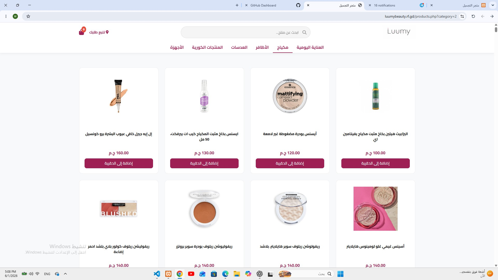
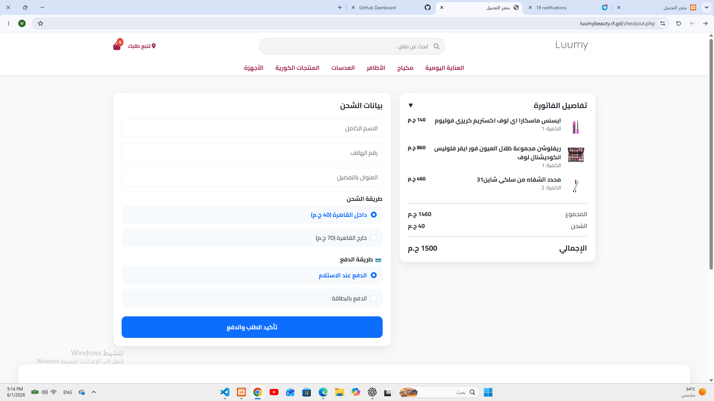
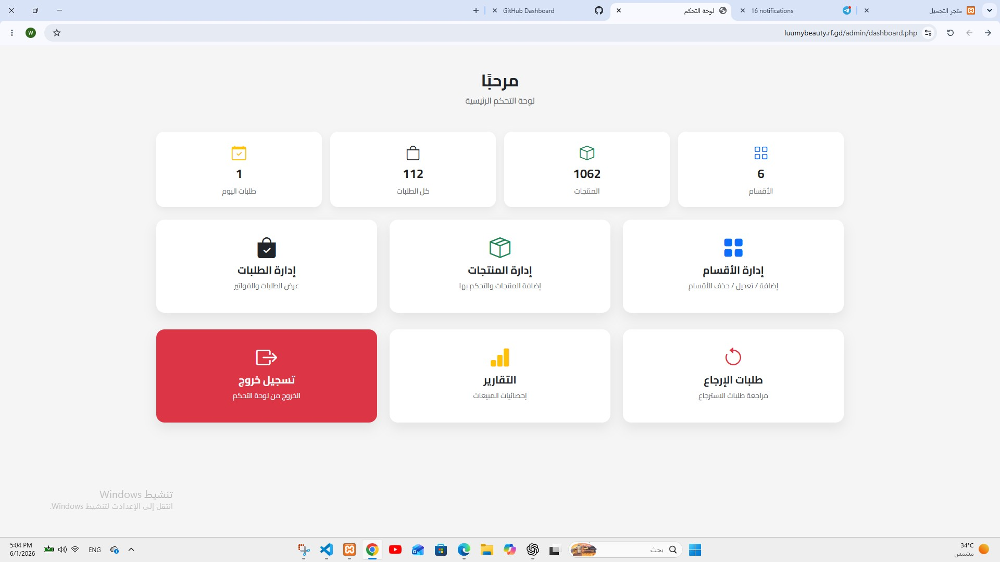
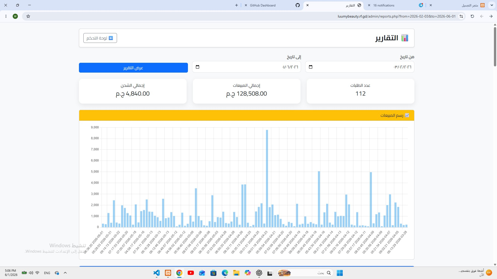
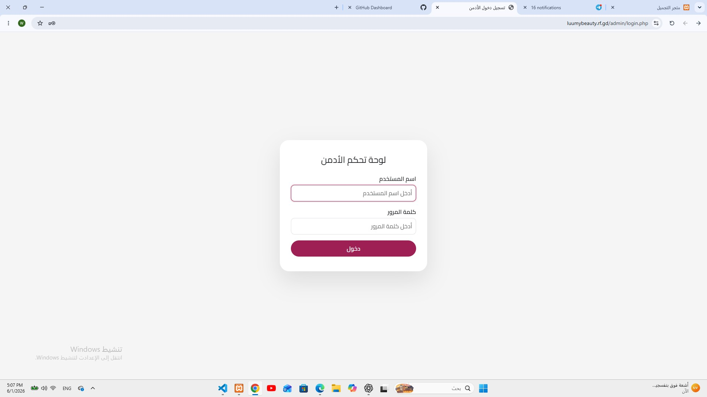

# Luumy Beauty Store

An online beauty and cosmetics store developed using PHP and MySQL with a modern responsive UI.
The system allows customers to browse products, add items to cart, place orders, track purchases, and request refunds.
It also includes a complete admin dashboard for managing products, categories, orders, reports, and refunds.

## Live Demo

[View Website](https://luumybeauty.rf.gd)

## Preview

### Home Page

Modern landing page with categories, featured products, promotional banners, and daily skincare collections.

### Products Page

Displays products based on selected categories with filtering, product cards, pricing, and add-to-cart functionality.

### Product Details Page

Detailed product page showing product images, description, price, stock status, ratings, and related products.

### Shopping Cart

Dynamic cart system with quantity control, product removal, and real-time total calculation.

### Checkout Page

Complete checkout system with customer information, shipping options, payment method selection, and order summary.

### Admin Dashboard

Complete dashboard for managing products, categories, orders, reports, and refunds.

## Features

### Customer Features

- Browse products by category
- Product search with AJAX
- Add to cart
- Update cart quantities
- Checkout system
- Order tracking
- Refund request system
- Product rating system
- Responsive design
- Dynamic pages (Privacy Policy, Terms, etc.)

### Admin Features

- Secure admin authentication
- Dashboard statistics
- Product management
- Category management
- Order management
- Refund management
- Invoice generation
- Reports & analytics
- Sales charts using Chart.js
- Low stock alerts
- Order status updates

## Technologies Used

- PHP
- MySQL
- Bootstrap 5
- HTML5
- CSS3
- JavaScript
- AJAX
- Chart.js

## Installation

1. Clone the repository

```bash
git clone https://github.com/we0d20-prog/luumy-beauty-store.git
```

2. Move the project folder into htdocs
3. Import database.sql into phpMyAdmin
4. Start Apache and MySQL using XAMPP
5. Open in browser

```bash
http://localhost/luumy-beauty-store
```

## Database

The project includes a ready-to-use SQL database file:

```bash
database.sql
```

Import it using phpMyAdmin before running the project.

## Screenshots

### Home Page


### Products


### Product 


### Cart


### Checkout


### Dashboard


### Reports


### Login


## Project Structure

```bash
luumy-beauty-store/
│
├── admin/
│   ├── auth.php
│   ├── categories.php
│   ├── dashboard.php
│   ├── invoice.php
│   ├── login.php
│   ├── logout.php
│   ├── order_details.php
│   ├── orders.php
│   ├── products.php
│   ├── refunds.php
│   ├── reports.php
│   ├── update_order_status.php
│   └── update_refund.php
│
├── assets/
│   ├── css/
│   ├── images/
│   └── js/
│
├── includes/
│   ├── db.php
│   ├── header.php
│   └── footer.php
│
├── screenshots/
│
├── ajax_add_to_cart.php
├── cart.php
├── checkout.php
├── index.php
├── pages.php
├── place_order.php
├── product.php
├── products.php
├── rate.php
├── refund.php
├── remove_from_cart.php
├── search_products.php
├── success.php
├── track_order.php
├── update_cart.php
│
├── README.md
├── .gitignore
└── database.sql
```

## Future Improvements

- Online payment integration
- User accounts system
- Wishlist functionality
- Email notifications
- Multi-language support
- Advanced product filtering

## Author

Waleed Sami

- GitHub: https://github.com/we0d20-prog/luumy-beauty-store.git
